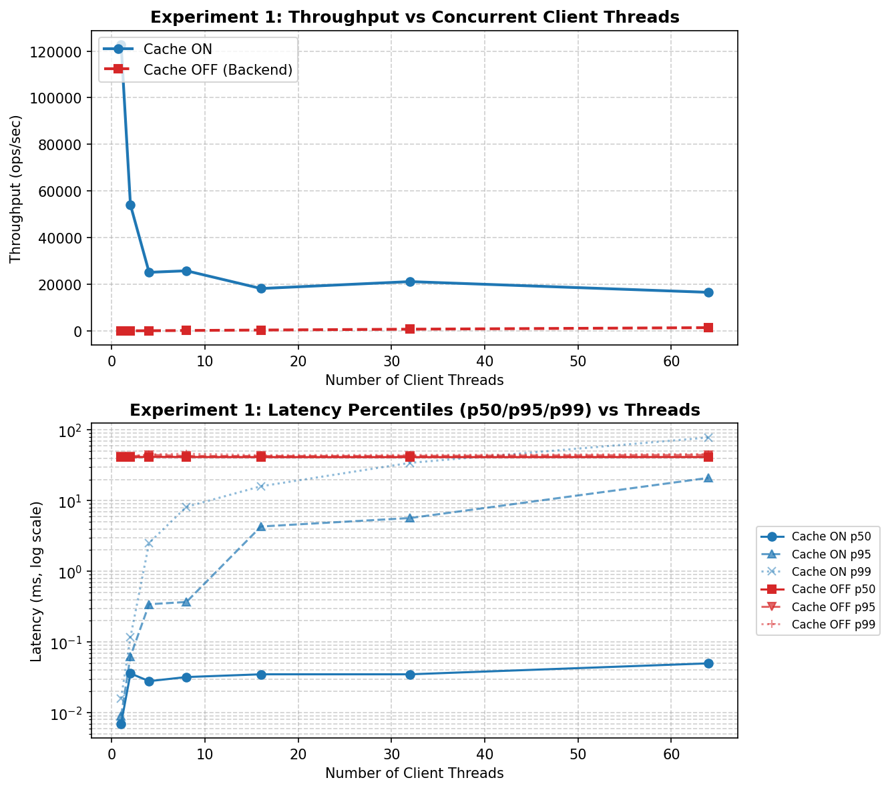
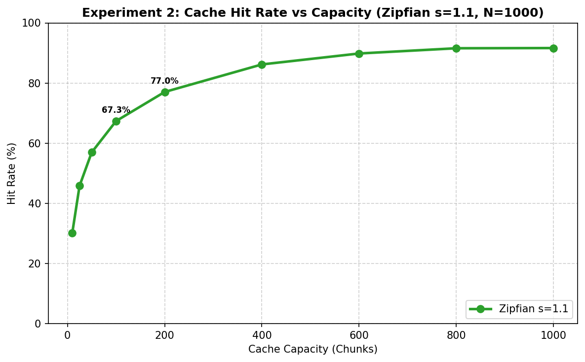
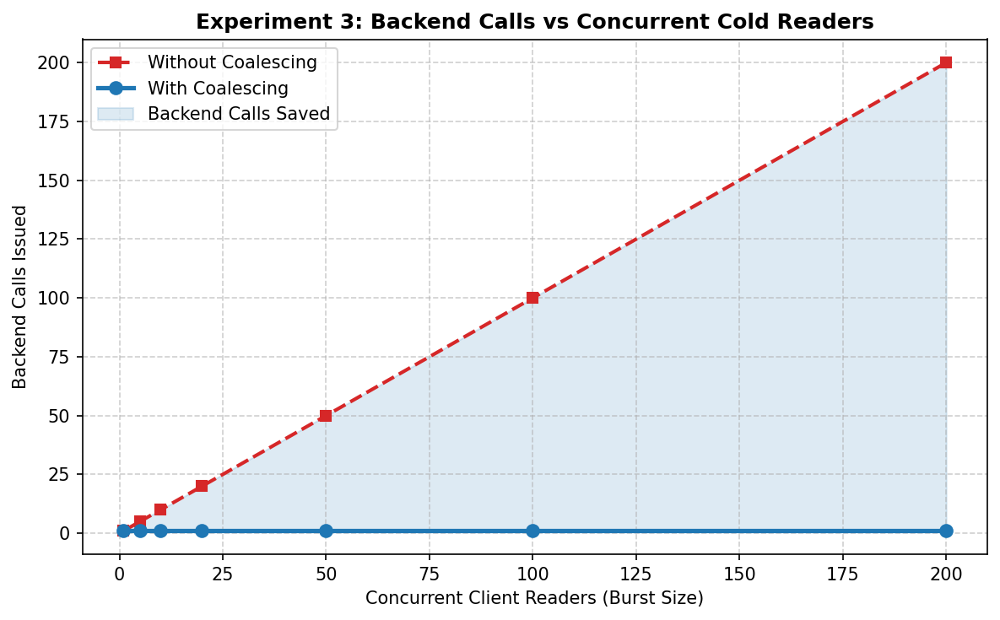
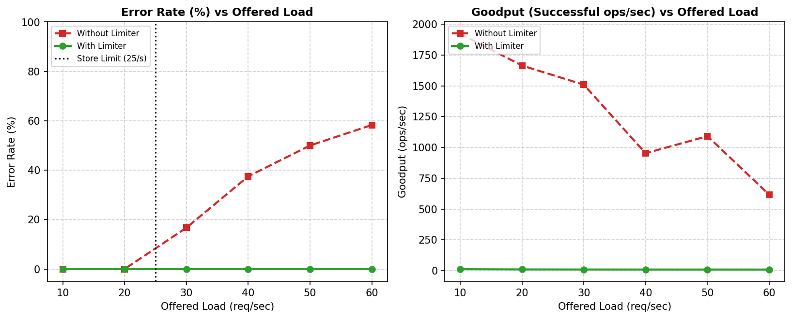

# MiniEdge

MiniEdge is a single-machine, thread-safe simulation of an edge-caching distributed filesystem inspired by the Nasuni architecture. It coordinates concurrent client access across edge nodes serving file reads and writes from an in-memory chunk cache, backed by an underlying object store that simulates latency, rate limits, and transient failures. Concurrency control and consistency are enforced using per-path leased locks with monotonically increasing fencing tokens, single-flight request coalescing to eliminate thundering herds on cache misses, optimistic compare-and-swap (CAS) versioning on all objects, and token-bucket ingress/egress rate limiters with jittered backoff retries.

---

## Architecture

```
                     clients (concurrent threads)
                                  │
       read(path, offset, length) │ write(path, offset, data)
                                  ▼
         ┌──────────────────────────────────────────────────┐
         │               EdgeNode (edge.py)                 │
         │  ┌────────────────────────────────────────────┐  │
         │  │ Ingress Per-Client Limiter (ratelimit.py)  │  │
         │  └────────────────────────────────────────────┘  │
         │  ┌────────────────────┐  ┌─────────────────┐     │
         │  │ ChunkCache         │  │ Leased Lock     │─────┼──────┐
         │  │ - LRU Eviction     │  │ Client          │     │      │
         │  │ - Coalescing (Miss)│  │ (locks.py)      │     │      │
         │  └────────────────────┘  └─────────────────┘     │      │
         │  ┌────────────────────────────────────────────┐  │      │
         │  │ Egress Backend Limiter (ratelimit.py)      │  │      │
         │  └────────────────────────────────────────────┘  │      │
         └────────────────────────┬─────────────────────────┘      │
                                  │                                │
            get(key) / put(key)   │ (rate-limited, retried)        │
                                  ▼                                ▼
         ┌───────────────────────────────────┐    ┌──────────────────────────────┐
         │    ObjectStore (object_store.py)  │    │  LockService (locks.py)      │
         │  - Simulated Latency & Outages    │    │  - Shared (Read) Leases      │
         │  - CAS Version Validation         │    │  - Exclusive (Write) Leases  │
         │  - Monotonic Fencing Tokens       │    │  - Monotonic Fencing Tokens  │
         └───────────────────────────────────┘    │  - Writer-Preference Queue   │
                                                  └──────────────────────────────┘
```

---

## Quickstart

### Prerequisites
- Python 3.11+
- Standard library only for core modules (`pytest` and `matplotlib` for tests and benchmarks).

### Installation
```bash
git clone https://github.com/shritaetta/miniedge.git
cd miniedge

# Create and activate a virtual environment
python -m venv .venv

# Windows:
.venv\Scripts\activate
# Linux/macOS:
# source .venv/bin/activate

# Install editable package with test and benchmark dependencies
pip install -e .[test,benchmark]
```

### Running Tests
Execute the complete test suite (61 tests covering unit, concurrency stress, chaos, and failure injection):
```bash
pytest -v
```

### Running Benchmarks
Run the automated benchmark suite to generate data and plots in `bench/results/`:
```bash
# Full benchmark run (~30 seconds)
python bench/run_bench.py

# Quick verification run (~5 seconds)
python bench/run_bench.py --quick
```

---

## Features Mapped to DESIGN.md

| Problem (from DESIGN.md §1) | Component | Implementation | Test Coverage |
|---|---|---|---|
| **Many clients, same hot data** | `ChunkCache` | Thread-safe LRU cache with generation tracking and dirty eviction hooks (`miniedge/cache.py`). | `tests/test_cache.py::test_lru_eviction_order` |
| **Thundering herd on cache miss** | `ChunkCache` | Request coalescing via `concurrent.futures.Future`; single leader loads backend, all waiters share result. | `tests/test_cache.py::test_100_threads_coalescing`, `tests/test_edge.py::test_100_concurrent_reads_cold_file_coalescing` |
| **Protecting backend from overload** | `TokenBucket` & `retry_with_backoff` | Lazy token bucket with exponential backoff and full jitter (`miniedge/ratelimit.py`). | `tests/test_ratelimit.py`, `tests/test_failures.py::test_throttling_limiter_on_vs_off` |
| **Two nodes editing the same file** | `LockService` | Distributed per-path read/write leases with strictly increasing fencing tokens and writer preference (`miniedge/locks.py`). | `tests/test_locks.py::test_compatibility_matrix`, `tests/test_locks.py::test_writer_preference` |
| **Node crash mid-write** | `LockService` & `ObjectStore` | Lease TTL expiry and store-level monotonic fencing token rejection (`miniedge/locks.py`, `miniedge/object_store.py`). | `tests/test_edge.py::test_kill_a_node_lease_expiry_and_fencing_rejection`, `tests/test_edge.py::test_fencing_rejects_stale_write_when_is_valid_monkeypatched` |
| **Conflicting writes** | `ObjectStore` | Compare-and-swap (CAS) version checks (`expected_version`) on every put (`miniedge/object_store.py`). | `tests/test_object_store.py::test_cas_conflict`, `tests/test_edge.py::test_two_edge_nodes_concurrent_increments` |
| **Write-back caching tradeoff** | `EdgeNode` | Optional `write_back=True` with in-memory dirty tracking, background flusher thread, pre-eviction dirty chunk flushing, and crash loss semantics (`miniedge/edge.py`). | `tests/test_edge.py::test_write_back_crash_before_flush_loses_data`, `tests/test_edge.py::test_write_back_eviction_flushes_dirty_chunks` |

---

## Benchmark Results

All benchmarks were executed locally with a simulated 20 ms backend round-trip latency (`bench/run_bench.py`).

### Experiment 1: Latency and Throughput vs Concurrent Clients
Evaluates read throughput and percentiles (p50, p95, p99) across 1 to 64 concurrent client threads with cache enabled vs disabled.



- **Cache Enabled:** Throughput reaches **122,759.5 ops/sec** at 1 thread and scales to **16,554.3 ops/sec** at 64 threads under contention. The median (p50) latency remains between **0.007 ms and 0.050 ms**.
- **Cache Disabled:** Throughput is strictly bottlenecked by the 20 ms simulated round-trip latency, scaling from **24.3 ops/sec** (1 thread) to **1,404.0 ops/sec** (64 threads). The median (p50) latency remains fixed at **~41.0 ms to 41.5 ms**.

### Experiment 2: Cache Hit Rate vs Cache Size (Zipfian Access)
Measures LRU hit rate across 10,000 requests over 1,000 unique chunks with a Zipfian skew parameter of $s = 1.1$.



- **Capacity 10 (1% of working set):** 30.15% hit rate (3,015 hits).
- **Capacity 100 (10% of working set):** 67.35% hit rate (6,735 hits).
- **Capacity 400 (40% of working set):** 86.19% hit rate (8,619 hits).
- **Capacity 800+ (80%+ of working set):** 91.57% – 91.64% hit rate (9,157 – 9,164 hits).

### Experiment 3: Backend Calls Saved by Request Coalescing
Measures backend loads triggered when bursts of 1 to 200 concurrent threads request the same cold chunk simultaneously.



- **With Coalescing:** Exactly **1 backend fetch** occurs regardless of concurrency (burst sizes 1, 5, 10, 20, 50, 100, 200).
- **Calls Saved:** At a 200-thread burst, coalescing saves **199 redundant backend loads** (a 99.5% reduction in backend traffic).

### Experiment 4: Rate Limiting Under Overload
Measures error rates and goodput when offered load (10 to 60 ops/sec) exceeds a backend capacity limit of 25 ops/sec.



- **Without Rate Limiter:** Backend throttles requests above capacity: error rate escalates from **0.0%** at 20 ops/sec to **16.7%** (30 ops/sec), **37.5%** (40 ops/sec), and **58.3%** (60 ops/sec), degrading system goodput.
- **With Rate Limiter:** Admissions are bounded to bucket refill rate, maintaining a **0.0% error rate** across all load levels up to 60 ops/sec.

---

## Known Limitations

*(Copied from DESIGN.md §9)*

- Single-process simulation; no real network partitions.
- Lock service is a single point of failure.
- Lease expiry relies on `time.monotonic()` within one process; real systems must handle clock skew between machines.
- Fixed-size chunking with no deduplication or compression.
- LRU is vulnerable to scan pollution.
- **Multi-chunk writes are not atomic:** Puts are applied chunk-by-chunk to the object store. If a write spanning multiple chunks fails midway (e.g. put #2 of 4 raises, process crash, or lease expiry), the chunks written prior to failure remain committed in the backend store, while subsequent chunks and `#meta` are not written. Readers after failure observe partially committed files unless an external transaction or manifest log rollback is implemented.
- **Retries can outlast the TTL:** Exponential backoff retries in `retry_with_backoff` during backend operations may sleep longer than the remaining lease TTL. If the lease expires while retrying, subsequent puts are rejected by fencing or the lease check. `EdgeNode` checks `locks.is_valid(lease)` inside the retry loop before each put attempt to fail fast with `LeaseExpired`.
- **Per-client state growth:** The client read-version map (`_client_read_versions`) and per-client rate limiters (`PerClientLimiter`) retain state keyed by `(client_id, key)` and `client_id`. Clients that read without writing, or clients that disconnect without cleanup, lead to unbounded dictionary memory growth unless an explicit LRU/TTL eviction or session-pruning mechanism is added.
